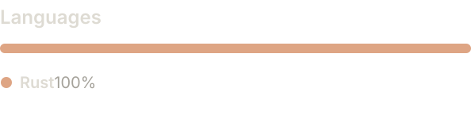

<p align="left"></p>

# Rustable

**Your query took 30ms. Why is your app still thinking?**

Rustable is a native database client. We wanted to click a table and see the table, run a query and get the results, and edit a value without feeling like we’d opened an accounting suite. So we’re making one.

It’s written in Rust. Of course it is. We also use mise, and mise is written in Rust. That’s how you know it’s good. Please don’t ask any follow-up questions about this methodology.

**App code: 100% Rust.** We’re not kidding. Even GitHub says so. [Check the sauce for yourself.](https://github.com/RustableApp/Rustable)

<a href="https://github.com/RustableApp/Rustable"></a>

<sub>GitHub’s breakdown covers the app; packaging and benchmark scripts are excluded.</sub>

**Current release: v0.3.2.** Early software, with rough edges and unfinished features. This isn’t a claim of complete TablePlus parity.

[Download for macOS (Apple Silicon)](https://github.com/RustableApp/Rustable/releases/latest/download/Rustable-macos-arm64.dmg) · [Windows (x64)](https://github.com/RustableApp/Rustable/releases/latest/download/Rustable-windows-x86_64.zip) · [Linux (x64)](https://github.com/RustableApp/Rustable/releases/latest/download/Rustable-linux-x86_64.tar.gz)

macOS is signed and notarized, with Sparkle updates. Windows and Linux are portable packages; updates are manual for now. Built-in SSH tunnels currently work on macOS and Linux; on Windows use a direct connection or an external tunnel. Linux packages target Ubuntu 24.04 or compatible newer systems.

## This isn’t a screenshot

[Try the live WASM demo →](https://rustable.app/#demo-title)

Rust, compiled to **WebAssembly**, running in your browser. Not a JavaScript rewrite. Why would you do that? Because you can. It’s written in Rust, dude. Imagine that.

The browser edition runs real SQLite against disposable sample data. Query it, change it, reset it. The UI is Rust/egui compiled to WASM; a small JavaScript bridge handles browser integration and SQLite’s WASM API. Real server connections and the full editing workflows live in the desktop app.

## What’s in it

- Saved connections and separate database windows.
- SSH tunnels, schema browsing, and credentials stored through the system credential store when enabled.
- Virtualized data grids, compound filters, pagination, row context menus, and a row inspector.
- SQL tabs, syntax highlighting, completion tooling, query history, and named saved queries grouped in folders.
- Staged table edits, undo, and a SQL review before saving.
- Result exports, light and dark themes, and keyboard shortcuts for the things you do repeatedly.

Rust + egui means a native, GPU-rendered UI that can redraw at your monitor’s refresh rate during interaction. You bought the nice monitor. Might as well use it for something besides the mouse cursor. Vsync is enabled; idle windows don’t deliberately redraw continuously.

You already have a browser. No need to ship another one to display some rows.

## Database support

PostgreSQL, SQLite, MySQL, and MariaDB are available. MySQL 8.4 and MariaDB 11.4 have been tested for browsing, SQL, TLS/SSH connections, import/export, and reviewed row edits. Reviewed MySQL/MariaDB writes require a primary key, InnoDB, and supported effective privileges; visual schema administration and a full MySQL language server remain unfinished. See [capabilities and limits](docs/MYSQL-MARIADB-RELEASE.md). Standalone Redis is included in v0.3.2, with a native key browser, command editor, TLS/ACL authentication, string edits, and TTL controls. See [Redis capabilities and limits](docs/REDIS.md).

### Why start with PostgreSQL and SQLite?

Because PostgreSQL is the only correct choice for a server-side SQL database, and SQLite is obviously, objectively awesome. These are completely unbiased engineering conclusions.

We can have opinions and still support your toy databases. More engines are coming.

### What about Windows and Linux?

Yes, we support your silly OS as well. Native Windows and Linux builds, alongside macOS. Unlike certain database explorers that cost money and are closed sauce. Very generous of us.

## Run it

Use [mise](https://mise.jdx.dev/) for the toolchain and Cargo for dependencies:

```sh
mise run dev
mise run check
mise run build

# macOS app bundle: target/Rustable.app
mise run bundle
```

Or run `mise exec rust@stable -- cargo run --release`. The Cargo lockfile is checked in.

The connection window is the starting point. Choose an existing SQLite database or configure PostgreSQL. The app won’t create a new SQLite file because you mistyped a path.

## About the speed thing

We’re spending time on connection reuse, unnecessary network round trips, bounded results, and keeping database work off the UI thread. The grid renders visible rows instead of rendering your entire regrettable `SELECT *`.

The goal is to feel immediate. We’re not going to turn that into a made-up “100× faster” claim. Measurements and implementation details live in [the performance notes](docs/PERFORMANCE.md).

Found something slow? Please include the database engine, what you did, and whether SSH was involved. Query timings, UI timings, and network latency are different things; useful reports help us find the right one.

## A few things to know

Results have limits. Export operates on loaded results, not automatically on your whole database. Query history and saved SQL live in local app data and may contain sensitive text. SQL editing and table editing also have different transaction behavior; see the driver and editing notes before relying on a particular workflow.

- [Driver capabilities](docs/DRIVER_CAPABILITIES.md)
- [PostgreSQL editing](docs/POSTGRES_EDITING.md)
- [Language servers](docs/LANGUAGE_SERVERS.md)
- [Automatic updates: current state](docs/AUTOMATIC_UPDATES.md)

Built for people who want to get their work done. Not clowns. 🤡 (Clowns may build from source.)

Other database apps are built for pros. Rustable is built for bros. Same SQL. Less ceremony.

## Handcrafted, obviously

Every line lovingly written by skilled artisans. Our artisan is called Astra and works suspiciously quickly.

Fine. It’s vibe coded. The source is here. The tests still have to pass.

## Isolated native QA

Build with `mise exec rust@stable -- cargo build --release --features qa` and copy the binary only to `target/Rustable QA.app/Contents/MacOS/rustable`. QA has its own window title and persistence namespace.

Build normal releases separately with `mise exec rust@stable -- cargo build --release`. Both use the same Cargo output path, so don’t copy the QA binary into the normal app bundle. Replace bundle executables atomically and restart only the intended app.
